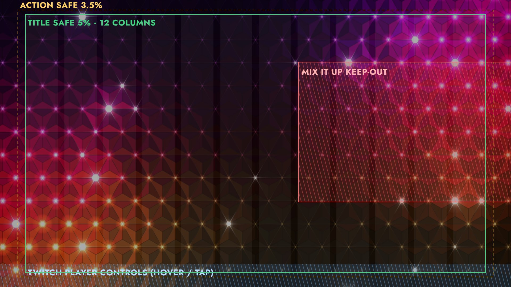
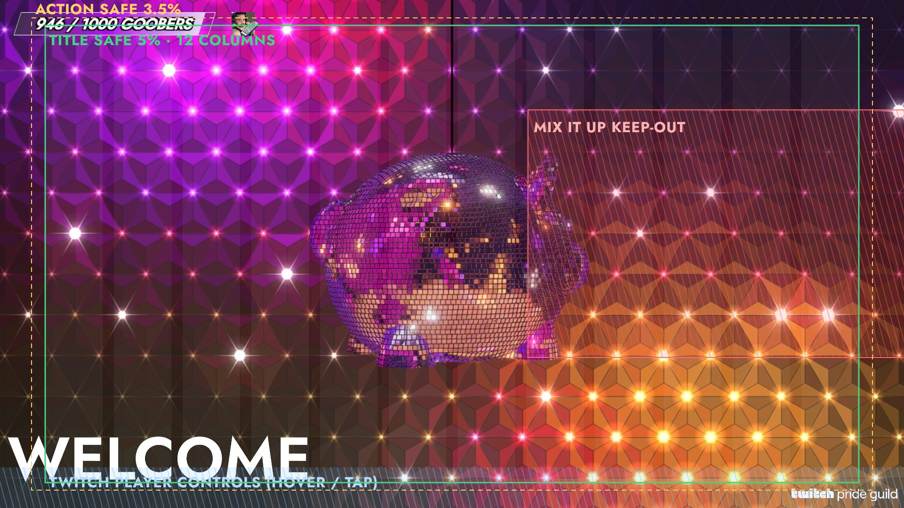
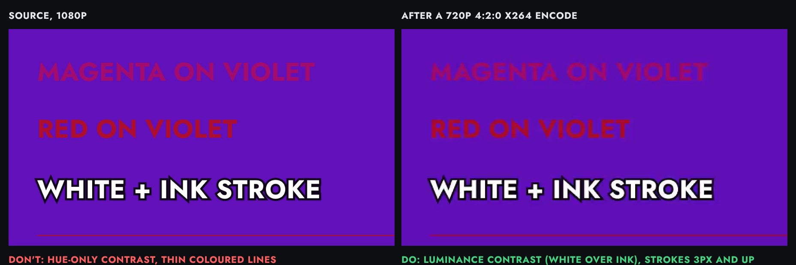
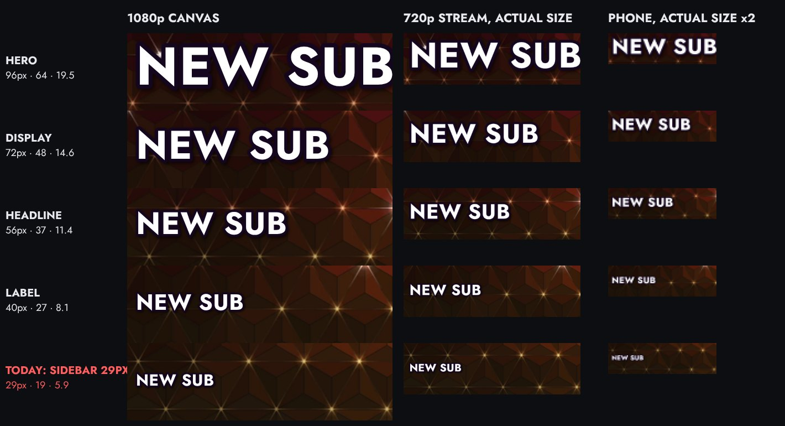
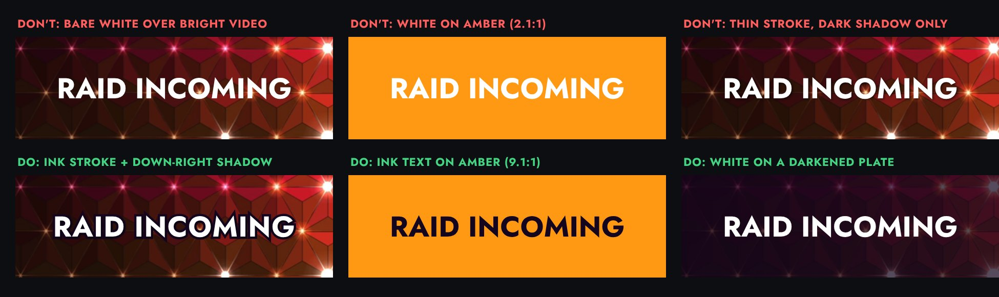
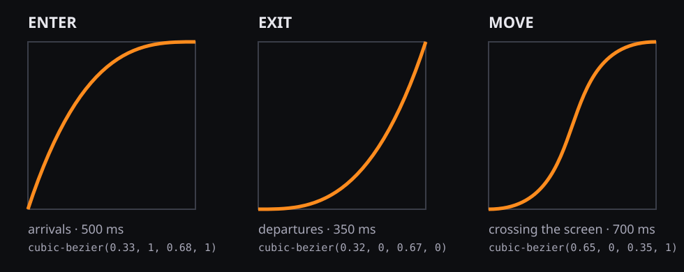
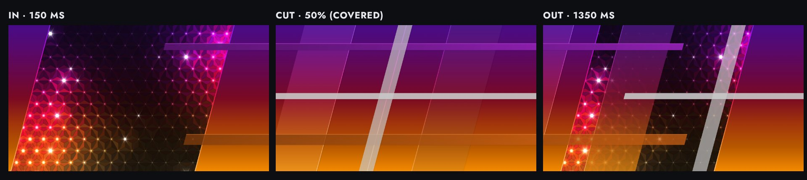
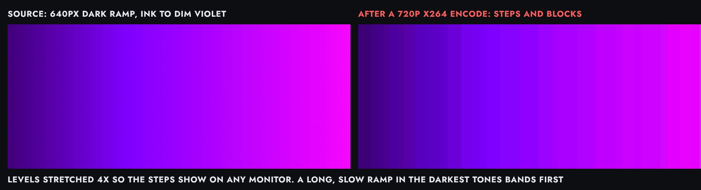

# The stream bible

How everything a viewer sees on AJ's stream should look and move: the
Illuminations broadcast look. The epcot ball's night gradient (violet crown
down to amber) is the stage; slanted bars in that gradient and white are the
one graphic language; text is big, white, ink-stroked and still while it is
read. Everything is judged at the size a viewer actually gets: a 720p
stream, often on a phone.

- Owner: the design system role, 📺 Rotom ([charter](roles/design-system.md)).
  Design review gates PRs against it ([charter](roles/design-review.md)).
- Tokens: `config.design` in [`src/config/config.js`](../src/config/config.js);
  math in `src/shared/design.js`; `tests/shared/design.test.js` holds every
  text pair to its contrast and the safe areas to SMPTE.
- Figures: `docs/design/`, rebuilt with `npm run design:figures` (see
  [Making designs](#making-designs)).
- One source per rule. Decisions already settled in
  [MOTION.md](MOTION.md) (palette always on, sidebar text at 78%, long-text
  fit, density 8, epcot first, Mix It Up band) are linked, not restated.
  When this doc and MOTION.md seem to disagree, MOTION.md's dated decision
  wins until this doc is fixed.
- Rules carry an id (`SAFE-2`, `TYPE-4`) so reviews and issues can cite them.

### Today vs target

Some rules describe where the stream is going, not what ships today. They
are **targets**: they gate new work, but a scene that predates them is not
failed against them until its audit issue lands (and, for a look AJ would
notice, AJ has picked it from mocks). Everything not in this table is in
force now.

| Rule | Target | Ships today |
|---|---|---|
| MOTION-1, motion tokens | Enter 500ms on `ease.enter`, exit 350ms on `ease.exit`, exits quicker than entries | Shade and sidebar ship it (#33-#35); the other scenes keep their own timings ([MOTION.md](MOTION.md), Timing) |
| TYPE-7 | Fonts bundled into the build | Jost from Google Fonts at runtime, or the machine's installed Jost |
| CUT-2 | At most 300ms of static full cover | 30% of `duration`: 300ms at the default 1000ms, 600ms at OBS's `duration=2000` |
| SAFE-1, SAFE-3 | Every word inside title-safe, none in the bottom 8% | OBS-placed text (goal bar, scene titles) at 20-30px from the edges |

**Scope** is the OBS program output (AJ, 2026-10-28): every scene, alert,
widget and transition a viewer sees. Control UIs that never reach the
program (the discoball lighting desk, the vtuber debug panel, OBS docks) are
out.

## Principles

1. **The content is the show.** AJ, the game and chat come first. Graphics
   frame them, announce events, then get out of the way.
2. **One family.** Every graphic is built from the same parts: 15° slants,
   the Illuminations gradient, white, ink, Jost. A new element that needs a
   new shape, colour or font is the wrong element.
3. **Legible at the far end.** Rules are set for a 720p encode on a phone,
   not for the 1080p canvas on AJ's monitor.
4. **Motion means something happened.** Ambient layers drift slowly and
   never compete; an alert moves once to arrive, holds still to be read,
   and leaves.
5. **Cheap.** The background, epcot, discoball and vtuber run all stream
   next to the game and the encoder ([PERFORMANCE.md](PERFORMANCE.md)).
   That beats every other goal.

## Canvas, grid and safe areas

Every scene is a 1920x1080 transparent OBS browser source. Viewers get it
scaled: most watch the 720p rendition, and a phone in portrait shows the
whole frame about 390px wide (x0.2).

| Token | Value | 1080p px | 720p px |
|---|---|---|---|
| `design.safe.actionInset` | 3.5% | 67 x 38 | 45 x 25 |
| `design.safe.titleInset` | 5% | 96 x 54 | 64 x 36 |
| `design.grid` | 12 columns, 24px gutters | margin 96 | 64 |
| `design.canvas.unitPx` | 8 | every gap and size a multiple of 8 | |
| `design.playerChromeTop` | 92% | y 994 and below | y 662 |

- **SAFE-1** Every word, number and face-critical element sits inside
  title-safe (96px from the sides, 54px from top and bottom). Only bars,
  fills, glows and decoration bleed past it, and they may run off the edge.
- **SAFE-2** Nothing that matters sits past action-safe. Phones crop
  differently, TVs overscan, and clip makers crop to 9:16 from the centre.
- **SAFE-3** Nothing a viewer must read sits in the bottom 8%: Twitch's
  player controls cover it on hover and tap.
- **SAFE-4** Align to the 12-column grid and the 8px unit. Persistent
  widgets sit on the title-safe edge, not at arbitrary pixels (today the
  goal bar sits at 20px, the Starting title at 30px).

### Keep-out zones

| Zone | Where | Rule |
|---|---|---|
| Mix It Up | Right side, about 58-100% across and 22-70% down (the padded union of `config.sidebar.miuZones`) | No overlay text there, ever. The decision and its numbers live in [MOTION.md](MOTION.md), Learnings (AJ, PR #17) |
| Player controls | Bottom 8% | SAFE-3 |
| Camera and vtuber | Wherever the scene puts AJ | Alerts never cover AJ's face; a takeover (tier 3) is the one exception, and it is brief |
| Persistent widgets | Top-left band (goal bar), bottom-right corner (Pride Guild) | A new widget takes a free grid slot inside title-safe; alerts don't land on a widget's text |

## Depth and layering

From back to front, every scene stacks on these planes:

| Plane | What | Look |
|---|---|---|
| 0 Stage | epcot recording, bar background | Darkest, slowest |
| 1 Content | Game capture, camera, vtuber, discoball | Untouched by graphics, except tier 3 alerts |
| 2 Persistent | Goal bar, notifications bar, badges | Small, still, inside title-safe |
| 3 Alerts | Sidebar, shade, Mix It Up props | One at a time per zone |
| 4 Transition | Stinger | Above everything, briefly |

- **DEPTH-1** One light, top-left. Every shadow falls down-right
  (`design.type.shadowOffsetEm`, the bars' `shared.shadow.offset`).
- **DEPTH-2** Farther is darker, more transparent and slower: curtains and
  panels sit 20 points darker (`palette.curtainLightness`) at 0.4-0.6
  opacity; coloured accents in front; white accents and text frontmost.
  Drift speed scales with depth (the stinger's 0.6-1.4x).
- **DEPTH-3** Brand marks (Twitch, Pride Guild) are content-plane badges:
  an alert draws above them, never under them.

## Colour

The Illuminations palette is the only colour source for graphics, painted as
one screen-fixed top-to-bottom gradient, always: AJ's decision, recorded with
its exceptions (single-band bars take it along their length) in
[MOTION.md](MOTION.md), Learnings. Every scene applies the 0.8 brightness
multiplier to HSL lightness (`shadeStops()`), and the "At 0.8" column is
that result.

| Stop | Hex | At 0.8 | White on it | Ink on it | Text rule |
|---|---|---|---|---|---|
| 0 Violet crown | #7a14e8 | #6110b7 | 9.3:1 | 2.1:1 | White, any size |
| 1 Purple | #a312c9 | #820ea0 | 8.3:1 | 2.3:1 | White, any size |
| 2 Magenta | #c90f8a | #a10c70 | 7.5:1 | 2.6:1 | White, any size |
| 3 Crimson | #d8123c | #af0e31 | 7.2:1 | 2.7:1 | White, any size |
| 4 Red-orange | #ef5a24 | #cc420f | 4.8:1 | 4.0:1 | White, any size |
| 5 Orange | #ff8c1e | #e66f00 | 3.2:1 | 6.2:1 | White at 56px+ with the stroke, or ink |
| 6 Amber | #ffb85c | #ff9914 | 2.1:1 | 9.1:1 | Ink only |
| White | #ffffff | | | 19.5:1 | Accents and text |
| Ink | #14061f | | 19.5:1 | | Strokes, shadows, dark text, plates |

- **COLOR-1** Graphics use only the stops, white and ink
  (`design.color`). Other colours appear only inside content (avatars,
  emotes, the game) and brand marks.
- **COLOR-2** Text pairs come from the table, which `design.test.js` holds:
  a new pair is added there first and must reach 4.5:1 (3:1 for display
  sizes, 56px and up).
- **COLOR-3** Contrast is luminance, not hue. Viewers get 4:2:0 video, with
  colour at half resolution, so magenta on violet or red on purple turns to
  mush however different the hues look on the canvas.
  
- **COLOR-4** White is an accent, not a field: no frame may be more than
  about 15% white, and never a full-screen white fill (FLASH-2).
- **COLOR-5** Don't use colour alone to mean something; pair it with a word
  or a shape.

## Type

One family: **Jost 700**, uppercase, `design.type`. Sizes on the 1080p
canvas, with what a viewer sees:

| Token | px | 720p | Phone | For |
|---|---|---|---|---|
| `hero` | 96 | 64 | 19.5 | Tier 3 takeovers (shade) |
| `display` | 72 | 48 | 14.6 | A name that is the point of the alert |
| `headline` | 56 | 37 | 11.4 | Tier 2 alerts (sidebar), scene titles |
| `label` | 40 | 27 | 8.1 | Persistent widgets (goal, notifications) |

- **TYPE-1** Nothing a viewer must read is under 40px (`minPx`). Alert
  text is 56px and up; a short action line set with it (the sidebar's
  "CHECK OUT") may be `label` 40px (#34).
- **TYPE-2** Uppercase, tracking +2% (`trackingEm`). Usernames keep their
  letters but render in caps like everything else.
- **TYPE-3** Text over anything that moves takes the recipe: an ink stroke
  of 0.08em (never under 3px, so 2px survives a 720p encode), painted
  under the fill, plus a soft ink shadow 0.04em down-right. Text on a solid
  plate needs only the plate.
  
- **TYPE-4** Text stands upright. The slant belongs to containers; no
  italic or skewed type. One exception: the top-left widget pair (the
  follower goal bar and the notifications toast that grows out of it) is
  Jost 700 italic, the "A Creative" look AJ picked in #27. The two stay
  matching, and nothing else borrows the italic.
- **TYPE-5** Counters use tabular figures (`font-variant-numeric:
  tabular-nums`) so a changing digit doesn't shift its neighbours.
- **TYPE-6** One line by preference, two at most, about 28 characters a
  line. Long text shrinks, then wraps, then ellipses, in that order: the
  rule and its 75% floor live in [MOTION.md](MOTION.md). The notifications
  toast is the exception: its bar grows to fit the line and the text stays
  still (MOTION.md Learnings, 2026-10-28, #31, built in #32).
- **TYPE-7** (target) Fonts are bundled into the single-file build, never fetched at
  runtime. A browser source that loads before Google Fonts answers, or
  offline, falls back to Arial for the whole alert.
- **TYPE-8** The words are stable: the on-screen text and the chat headline
  for the same event say the same thing.

## Geometry

- **GEO-1** The slant is 15°: slanted bars rotate 15° clockwise and
  horizontal bars skew -15° ([MOTION.md](MOTION.md), Look). Every container
  edge that angles uses it. No other angles.
- **GEO-2** Corners are square. No rounded rectangles, pills or circles in
  graphics (avatars from Twitch are content).
- **GEO-3** Lines are 3px or more on the 1080p canvas, 4px if they move.
  A 2px line drops to 1.3px at 720p and shimmers as it moves.
- **GEO-4** Bars come in the configured widths (white accents 40-120px,
  coloured 150-450px); a scene that needs another size says why in config.

## Motion

| Token | Value | For |
|---|---|---|
| `ease.enter` | cubic-bezier(0.33, 1, 0.68, 1) | Arrivals: fast in, long settle |
| `ease.exit` | cubic-bezier(0.32, 0, 0.67, 0) | Departures: speeds up as it goes |
| `ease.move` | cubic-bezier(0.65, 0, 0.35, 1) | Crossing the screen; today's `easeInOutCubic` |
| linear | | Loops and drifts only |
| `durationMs.micro` | 150 | A value or colour swapping in place |
| `durationMs.exit` | 350 | Leaving |
| `durationMs.enter` | 500 | An alert or widget arriving |
| `durationMs.move` | 700 | A bar crossing the screen |
| `durationMs.stagger` | 60 | Between siblings arriving |
| `settleMs` | 150 | Stillness after an arrival before it counts as readable |

- **MOTION-1** (target timings) Enter, hold, exit. Every alert arrives (enter), sits still to
  be read (hold), and leaves (exit). Exits are quicker than entries. The
  text itself is still for the whole hold: moving text smears in the encode
  and can't be read on a phone.
- **MOTION-2** Phases add up to the duration and hand over with
  continuous velocity; the build conventions are in
  [VALIDATION.md](VALIDATION.md) and the `motion-create` skill.
- **MOTION-3** Anticipation and settle are small: a lead element moves a
  stagger before the rest, and an arrival eases out. No bounce, overshoot or
  elastic on our graphics (Mix It Up's own bounce-in props are content).
- **MOTION-4** Stagger siblings by 60ms, in reading order (left to right,
  top to bottom, or along the slant).
- **MOTION-5** Ambient motion (tier 0) is slow: periods of 8s or more, no
  element crossing more than about a tenth of the screen a second, and no
  sudden change. It keeps running under alerts but never starts a burst
  during one.
- **MOTION-6** Everything is timed in ms on delta time, so 30, 60 and
  120 Hz look the same (CLAUDE.md, Conventions).
- **MOTION-7** Motion in a frame is limited: while an alert holds, nothing
  else that wants to be read moves.

### Transitions (the stinger)

- **CUT-1** The screen is fully covered at the cut with at least two frames
  to spare either side, and the cut is at 50% of the URL's `duration`. The
  URL duration and OBS's Transition point change together (the vault's Alert &
  Transition Wiring note; [SCENES.md](SCENES.md)).
- **CUT-2** (target) The full cover is a moment, not a hold: at most 300ms of static
  cover (`staticCoverMaxMs`), with the bars still moving through it. The
  whole stinger is 800-1500ms; the cut lands on its busiest frame.
- **CUT-3** Motion keeps its direction through the cut, so the eye reads one
  sweep, not two.
- **CUT-4** A transition sound peaks at the cut.
- **CUT-5** The stinger is a full-field change, so it counts against
  FLASH-2: never two within a second, never mostly white.

## Alerts

### Hierarchy

| Tier | What | Scene | Zone | Rule |
|---|---|---|---|---|
| 0 Ambient | epcot, bar background, discoball | Always on | Stage | MOTION-5; no text |
| 1 Persistent | Goal bar, notifications bar, badges | Always on | Top-left band, corners | Still; a change is a 150ms swap or one short celebration |
| 2 Side | Sub, resub, gift, hug, pet, treat, shoutout, hype level | Sidebar | Right, below the Mix It Up band | Never covers the content's centre |
| 3 Takeover | Raid, hype train start, mass gift | Shade | Full screen | The only tier that may cover AJ |
| T | Scene change | Stinger | Full screen | CUT rules |

- **ALERT-1** One alert per zone at a time (`design.alerts.maxConcurrent`),
  500ms apart (`gapMs`). A tier 3 waits for a tier 2 in progress to exit,
  then goes before any queued tier 2.
- **ALERT-2** The attention budget: a viewer can follow one new thing at a
  time. An alert never lands on top of another alert, a scene change or a
  widget's celebration.
- **ALERT-3** The bigger the tier, the rarer and shorter: a takeover holds
  no longer than its words need.

### Timing

- **TIME-1** Reading time: the hold, still and fully on screen, is at least
  200ms a word and never under 3s ([MOTION.md](MOTION.md), Timing). Enter
  and exit don't count. An alert whose `duration` can't fit enter + hold +
  exit grows its duration; it never cuts the hold.
- **TIME-2** Sound: the alert's sting lands when the enter finishes (within
  about 50ms). Mix It Up starts the sound with the alert, so enters stay
  short (500ms) for the two to land together.
- **TIME-3** TTS: the text is on screen before the voice starts, and stays
  until the voice ends plus 500ms.
- **TIME-4** Chat and the stream disagree by the stream delay: chat sees a
  headline 2-5s before the video shows the alert. The alert stays the
  authority; don't build anything that depends on the two lining up.

## Accessibility

- **FLASH-1** No more than 3 flashes a second over more than a quarter of
  the screen (WCAG 2.3.1, ITU-R BT.1702, Ofcom): a flash is a luminance
  swing of 10% or more and back. `design.flash.maxPerSecond`.
- **FLASH-2** A full-screen luminance swing (the stinger, a takeover's
  arrival) happens at most once a second (`fullFieldMaxPerSecond`), and
  saturated red never fills the screen in a flash.
- **FLASH-3** Sparkle and twinkle stay small: no bulb or glint larger than
  about 2% of the screen strobes faster than 3 times a second.
- **READ-1** Durations come from reading time (TIME-1), not from the
  animation.

## Compression

Viewers see an x264 or NVENC encode at a few megabits a second, mostly 720p,
with colour at half resolution. Design for what survives it.

- **ENC-1** Long, slow gradients in the darkest tones band. Keep big
  gradients short or in the lit part of the palette; over the dark epcot
  shadows, prefer flat fills or the lattice's own texture.
- **ENC-2** Full-screen fast motion starves the bitrate and blocks: keep it
  to the stinger and takeovers, about a second at a time.
- **ENC-3** Large areas are flat or smooth. Noise, grain and particles over
  big areas cost bitrate and come out as mush; detail belongs on small,
  still things.
- **ENC-4** Thin lines and small text move badly (GEO-3, TYPE-1); text is
  still while it is read (MOTION-1).
- **ENC-5** Contrast in luminance, not hue (COLOR-3).

## Performance

The budgets and how to measure them are in [PERFORMANCE.md](PERFORMANCE.md).
Design rules that keep them:

- **PERF-1** Always-on scenes (epcot, background, discoball, vtuber) run at
  30 fps unless a test shows 60 is needed, and stop redrawing when nothing
  changes.
- **PERF-2** A look that needs per-frame blur, large shadows or filters is
  cached in an offscreen canvas or redesigned (CLAUDE.md, Rendering).
- **PERF-3** Prefer a recorded loop for an always-on look that doesn't
  react to anything (the epcot recording is the model).

## Scenes at a glance

| Scene | Tier | Zone | Type | Motion | Notes |
|---|---|---|---|---|---|
| epcot (recorded loop) | 0 | Stage | none | 48s loop | The main background ([MOTION.md](MOTION.md)) |
| bar background | 0 | Stage | none | Drift | Rarely used, 8 bars |
| discoball | 0 | Content | none | Spin | One per scene; inside title-safe |
| vtuber | 1 | Content | none | Idle | Never under an alert's text |
| goal bar | 1 | Top-left, title-safe | `label` 40px | Still; swap on change | Rebuild in progress (Follower widget thread) |
| notifications bar | 1 | Top band | `label` 40px | One toast at a time | AJ chose "A Creative", PR #27 |
| sidebar | 2 | Right panel, text at 78% | `headline` 56px name, `label` 40px action | Enter, hold, exit | Text on an ink nameplate, right edge on title-safe (#34) |
| shade | 3 | Full screen | `hero` 96px | Enter, hold, exit | Text still and whole during the hold |
| stinger | T | Full screen | none | 800-1500ms | CUT rules |

## Review checklist

Walk it on harness frames composited over the epcot frame, and on a live
capture when OBS adds layers on top. Cite the rule id for each finding.

1. Every word inside title-safe, nothing readable in the bottom 8% or the
   Mix It Up band (SAFE-1 to 3).
2. Text 40px or more; alert text 56px or more; checked at 720p and phone
   size (TYPE-1).
3. Text on a tested pair, or with the stroke recipe over video (COLOR-2,
   TYPE-3); contrast by luminance (COLOR-3).
4. Jost 700, uppercase, upright, bundled (TYPE-2, 4, 7).
5. Only the stops, white and ink; 15° slants; square corners; lines 3px+
   (COLOR-1, GEO-1 to 3).
6. Enter, hold, exit on the motion tokens; text still for a hold of at
   least its reading time (MOTION-1, TIME-1).
7. Stinger: covered at the cut, static cover 300ms or less (CUT-1, 2).
8. One alert per zone, nothing landing on another (ALERT-1, 2).
9. No more than 3 flashes a second; no full-field white or red flash
   (FLASH-1, 2).
10. No long dark gradients, no full-screen noise (ENC-1, 3).
11. Within the frame budget (PERF; the harness and `npm run bench`).

## Making designs

- `npm run motion -- <scene> --seeds=1-3 --out=<name> --params=k=v` renders a
  look into its own folder; `npm run motion:compare` puts runs side by side
  over a backdrop. See [VALIDATION.md](VALIDATION.md).
- `npm run design:figures -- --bg=<epcot frame> --live=<obs capture>`
  rebuilds this doc's figures from the tokens (needs ffmpeg and the
  harness's `--out=bible` run). Rebuild them whenever a token changes.
- Live captures of the OBS program come from Defiant through the coordinator
  (the "Connect to OBS on Defiant" thread), only while AJ isn't live.
- A look AJ would notice goes to AJ as side-by-side mocks with a
  recommendation (CLAUDE.md, Shipping); everything else ships through
  review.
- An audit issue that moves a scene toward a target rule (Today vs target)
  goes through Design review, then to AJ as side-by-side mocks, before
  anyone builds it. Those issues carry the `design-decision` label.
- Audits file one issue per improvement, labelled `design-audit`, each
  citing the rule ids it breaks. The before/after images live in
  `docs/design/audit/` (first audit: 2026-10-28, live OBS captures plus
  harness renders).
